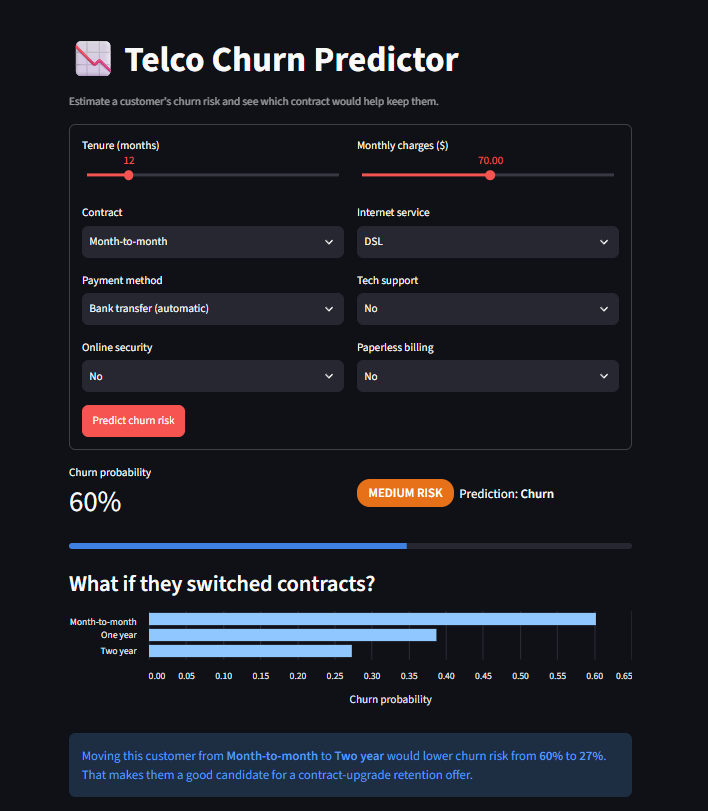
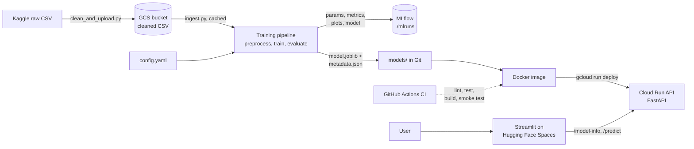
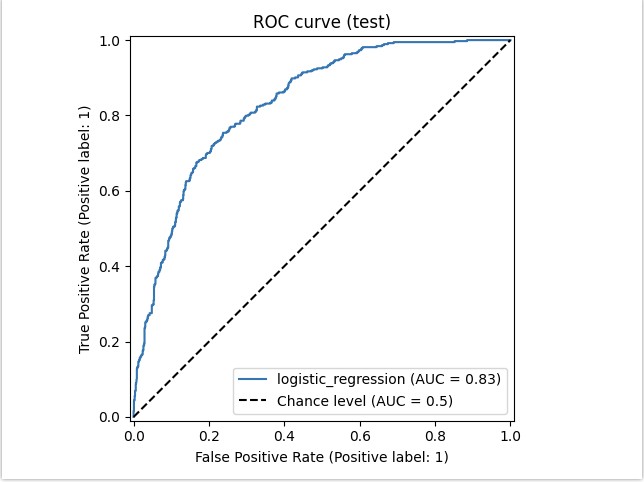
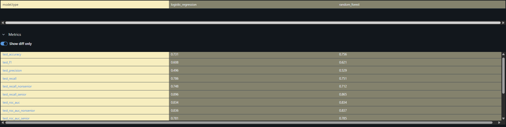
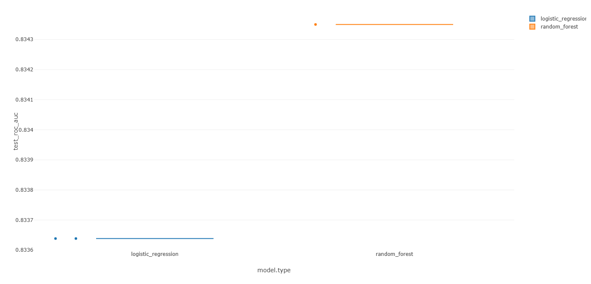

# Telco Churn MLOps: From Data to Decisions

**Predict which telecom customers are likely to churn, and which contract offer would keep them, using a reproducible, cloud-deployed ML pipeline.**

[](https://github.com/john-fillingim/telco-churn-mlops/actions/workflows/ci.yml)

| | Live link |
|---|---|
| 🖥️ **Front-end** (Streamlit on Hugging Face Spaces) | https://huggingface.co/spaces/JohnFillingim/telco-churn-predictor |
| ⚙️ **API docs** (FastAPI on Google Cloud Run) | https://telco-churn-api-681878559627.us-central1.run.app/docs |

> The API scales to zero when idle, so the first request after a quiet period can take ~10–20 s.



---

## Contents
1. [Overview & goals](#1-overview--goals)
2. [Dataset & cleaning](#2-dataset--cleaning)
3. [Architecture](#3-architecture)
4. [Model & evaluation](#4-model--evaluation)
5. [Experiment tracking (MLflow)](#5-experiment-tracking-mlflow)
6. [Cloud services used](#6-cloud-services-used)
7. [Setup](#7-setup)
8. [How to train](#8-how-to-train)
9. [How to build & test the API locally](#9-how-to-build--test-the-api-locally)
10. [How to deploy](#10-how-to-deploy)
11. [Ethics & limitations](#11-ethics--limitations)
12. [Repository structure](#12-repository-structure)
13. [Git workflow](#13-git-workflow)

---

## 1. Overview & goals

Losing a subscriber costs a telecom far more than keeping one. However, retention teams can't call every customer. This project turns historical customer data into a **ranked churn-risk score** that a retention team can act on:

- **Who to contact first:** each customer gets a churn probability and a low/medium/high risk level.
- **What to offer:** a *what-if* panel re-scores the same customer under each contract type, showing whether a contract-upgrade offer would reduce their risk.

The project is about **MLOps practice**, not squeezing out accuracy. The goals are:

- **Reproducible:** one config file, a fixed seed, pinned dependencies, and the same metrics on every run.
- **Modular:** separate, tested modules for ingestion, preprocessing, training, evaluation, and serving.
- **Tracked:** every training run is logged to MLflow with params, metrics, plots, the model, and the git SHA.
- **Deployed:** a containerized API on Cloud Run and a public front-end on Hugging Face Spaces.
- **Automated:** CI lints, tests, builds the Docker image, and smoke-tests the running container on every PR.

## 2. Dataset & cleaning

**Source:** [IBM Telco Customer Churn (Kaggle)](https://www.kaggle.com/datasets/blastchar/telco-customer-churn). It has 7,043 customers × 21 columns from a fictional telecom company. The target is `Churn` (Yes/No), with about 26.6% churners.

**Cleaning** ([`scripts/clean_and_upload.py`](scripts/clean_and_upload.py), run once):
1. `TotalCharges` is stored as text, with blank strings for 11 brand-new customers (tenure 0). The script converts it to a number and **drops the 11 unparseable rows**, leaving 7,032.
2. It maps `Churn` Yes/No to 1/0.
3. It drops `customerID` (an identifier, not a signal).
4. It keeps `SeniorCitizen`, but **only for fairness evaluation, not as a model feature** (see [Ethics](#11-ethics--limitations)).
5. It saves the cleaned CSV and uploads it to a private **Google Cloud Storage** bucket. Training then downloads it from GCS with [`src/data/ingest.py`](src/data/ingest.py), and caches it locally.

**Model features (the API contract):** 8 features were chosen for being interpretable and easy to collect:

| Feature | Type | Allowed values / range |
|---|---|---|
| `tenure` | int | 0–72 months |
| `MonthlyCharges` | float | 18.0–120.0 |
| `Contract` | category | Month-to-month, One year, Two year |
| `InternetService` | category | DSL, Fiber optic, No |
| `PaymentMethod` | category | Electronic check, Mailed check, Bank transfer (automatic), Credit card (automatic) |
| `TechSupport` | category | Yes, No, No internet service |
| `OnlineSecurity` | category | Yes, No, No internet service |
| `PaperlessBilling` | category | Yes, No |

## 3. Architecture



**Key design choice:** preprocessing (scaling and one-hot encoding) lives *inside* the saved scikit-learn `Pipeline`. The API therefore accepts raw values like `"Month-to-month"`, and training and serving can never apply different transformations. The trained model is baked into the Docker image, so the API needs no GCS or MLflow access at runtime.

## 4. Model & evaluation

- **Models:** a scikit-learn `Pipeline` made of a `ColumnTransformer` (StandardScaler for numbers, OneHotEncoder with `handle_unknown="ignore"` for categories) followed by either **Logistic Regression** or **Random Forest**. Both use `class_weight="balanced"` because churners are the minority class.
- **Split:** stratified 70% train / 10% validation / 20% test (4,921 / 704 / 1,407 rows), `seed=42`.
- **Primary metric:** ROC-AUC. It measures how well the model *ranks* customers by risk, which is exactly what is needed to prioritize outreach. The table below also reports F1, precision, recall, and accuracy at a 0.5 threshold.

**Test-set results** (from MLflow):

| Model | ROC-AUC | F1 | Precision | Recall | Accuracy |
|---|---|---|---|---|---|
| **Logistic Regression** (deployed) | **0.834** | 0.608 | 0.496 | 0.786 | 0.731 |
| Random Forest | 0.834 | 0.621 | 0.529 | 0.751 | 0.756 |

Both models rank customers equally well. **Logistic regression is deployed** because it is simpler, faster, interpretable (its coefficients are readable), and it has higher recall, so it misses fewer churners. That is the right trade-off when a missed churner costs more than an extra outreach call.



> **Note:** model accuracy is deliberately *not* the focus of this project. No hyperparameter tuning was done. The emphasis is on a reproducible, tested, deployed pipeline.

## 5. Experiment tracking (MLflow)

Every training run logs the following to a local MLflow file store (`./mlruns`):

- **Params:** the full flattened `config.yaml`, row count, and a hash of the training data.
- **Metrics:** `val_*` and `test_*` for ROC-AUC, F1, precision, recall, and accuracy, plus fairness metrics `test_roc_auc_senior`, `test_roc_auc_nonsenior`, `test_recall_senior`, and `test_recall_nonsenior`.
- **Artifacts:** the confusion matrix, ROC curve, and feature-importance plots; `config.yaml` and the resolved config (including CLI overrides); and the model, logged with a signature and an input example.
- **Tags:** the git commit SHA and the model type.



**Reproducibility:** the same config and seed give the same metrics. Two logistic-regression runs on the same commit produced identical numbers on every metric, as the box plot below shows (both LR runs sit at exactly 0.8336; the y-axis is heavily zoomed in). A test enforces this: `tests/test_train_smoke.py::test_same_seed_same_metrics`.



To reproduce and browse the runs:
```bash
python -m src.models.train                                # logistic regression (default)
python -m src.models.train --model-type random_forest
python -m mlflow ui --backend-store-uri ./mlruns --port 5000   # open http://127.0.0.1:5000
```

## 6. Cloud services used

| Service | Used for | Why |
|---|---|---|
| **Google Cloud Storage** | Stores the cleaned dataset (private bucket, public access blocked) | Durable, versionable data source that is separate from code; accessed with Application Default Credentials, so no key files exist |
| **Google Cloud Run** | Hosts the FastAPI container (public HTTPS) | Serverless containers that **scale to zero** (near-zero cost when idle) and need no servers to manage |
| **Cloud Build + Artifact Registry** | Build and store the API image on `gcloud run deploy --source .` | No local Docker needed to deploy |
| **Hugging Face Spaces** | Hosts the Streamlit front-end (Docker Space) | Free, public hosting for ML demos |
| **GitHub Actions** | CI on every PR and push to `main` | Lints, tests, builds the image, and smoke-tests the running container |

## 7. Setup

**Prerequisites:** Python 3.11 (3.10 also works locally), Git, and the [Google Cloud CLI](https://cloud.google.com/sdk/docs/install). Docker and `make` are optional.

```bash
git clone https://github.com/john-fillingim/telco-churn-mlops.git
cd telco-churn-mlops
python -m venv .venv
source .venv/bin/activate          # Windows: .venv\Scripts\Activate.ps1
pip install -r requirements-dev.txt    # or: make setup

# GCP auth (Application Default Credentials; no key files)
gcloud auth application-default login
```

To use your own bucket, edit `data.gcs_bucket` in [`config.yaml`](config.yaml). All paths, ratios, hyperparameters, and thresholds live in that one file.

**One-time data step:** download `WA_Fn-UseC_-Telco-Customer-Churn.csv` from Kaggle into `data/`, then run:
```bash
python -m scripts.clean_and_upload     # or: make data   (use --skip-upload to stay local)
```

## 8. How to train

```bash
python -m src.models.train --config config.yaml           # or: make train
python -m src.models.train --model-type random_forest     # CLI override
python -m src.models.train --force-download               # re-pull data from GCS
```
This downloads the data from GCS (cached in `data/`), splits, trains, evaluates, logs to MLflow, and exports `models/model.joblib` and `models/metadata.json`. The metadata holds the model version (git SHA), feature schema, test metrics, and MLflow run ID.

**Run the tests** (no GCP credentials needed; they use a synthetic dataset):
```bash
pytest -q          # or: make test
ruff check .       # or: make lint
```

## 9. How to build & test the API locally

**Run with Python:**
```bash
uvicorn src.api.main:app --reload --port 8080      # or: make serve
# Interactive docs: http://127.0.0.1:8080/docs
```

**Or with Docker:**
```bash
docker build -t telco-churn-api .                  # or: make docker-build
docker run --rm -p 8080:8080 telco-churn-api       # or: make docker-run
```

**Endpoints**

| Method | Path | Returns |
|---|---|---|
| GET | `/health` | `{"status": "ok"}` |
| GET | `/model-info` | model type, version, test metrics, and the feature schema (used to build the front-end form) |
| POST | `/predict` | `churn_probability`, `prediction` (Churn / No Churn), `risk_level` (low < 0.33 ≤ medium < 0.66 ≤ high), `model_version` |

**curl examples** (swap in the Cloud Run URL to hit production):
```bash
curl http://127.0.0.1:8080/health

curl -X POST http://127.0.0.1:8080/predict \
  -H "Content-Type: application/json" \
  -d '{"tenure": 3, "MonthlyCharges": 89.5, "Contract": "Month-to-month",
       "InternetService": "Fiber optic", "PaymentMethod": "Electronic check",
       "TechSupport": "No", "OnlineSecurity": "No", "PaperlessBilling": "Yes"}'
# {"churn_probability":0.8978,"prediction":"Churn","risk_level":"high","model_version":"0103a4b"}
```
Invalid input, such as an unknown category, an out-of-range number, a missing field, or an extra field, returns **422** with field-level messages. Stack traces are never exposed.

**Smoke-test any running instance:**
```bash
bash scripts/test_endpoint.sh http://127.0.0.1:8080
bash scripts/test_endpoint.sh https://telco-churn-api-681878559627.us-central1.run.app
```

## 10. How to deploy

**API → Cloud Run** (builds the Dockerfile with Cloud Build; no local Docker needed):
```bash
gcloud services enable run.googleapis.com cloudbuild.googleapis.com artifactregistry.googleapis.com
gcloud run deploy telco-churn-api --source . --region us-central1 \
  --allow-unauthenticated --memory 512Mi --min-instances 0 --max-instances 2   # or: make deploy
bash scripts/test_endpoint.sh <SERVICE_URL>
```
> If the first deploy fails with `PERMISSION_DENIED ... default service account is missing required IAM permissions`, grant the build service account the Cloud Run Builder role:
> `gcloud projects add-iam-policy-binding <PROJECT_ID> --member=serviceAccount:<PROJECT_NUMBER>-compute@developer.gserviceaccount.com --role=roles/run.builder`

**Front-end → Hugging Face Spaces:**
1. Create a new Space with **SDK: Docker** (Blank template).
2. Upload the 4 files in [`frontend/`](frontend/): `app.py`, `requirements.txt`, `Dockerfile`, and `README.md`. The README header sets `sdk: docker` and `app_port: 7860`.
3. In Space **Settings → Variables**, set `API_URL` to the Cloud Run URL.

Run the front-end locally with `streamlit run frontend/app.py` (or `make frontend`).

## 11. Ethics & limitations

Full details are in the **[Model Card](MODEL_CARD.md)**.

- **Intended use:** to *prioritize retention outreach*, deciding whom to contact first and which offer to make. It is **not** for denying service, setting individual prices, or any decision that penalizes a customer.
- **Fairness check:** `SeniorCitizen` is **excluded from the model's features** on purpose, but it is kept to audit performance by subgroup:

  | Test subgroup | n | Actual churn rate | ROC-AUC | Recall |
  |---|---|---|---|---|
  | Senior citizens | 232 | 41.4% | 0.781 | 0.896 |
  | Non-seniors | 1,175 | 23.7% | 0.836 | 0.748 |

  The model *ranks* seniors less accurately (ROC-AUC 0.78 vs 0.84). It also flags a larger share of senior churners (higher recall), partly because seniors churn more. Because seniors aren't a feature, these differences come from correlated features such as contract type and payment method. Teams should monitor this gap rather than assume the model is equally reliable for everyone.
- **Data limitations:** the data comes from **one fictional telecom** at a single point in time and is fairly small (7k rows). Results may not transfer to real companies, other regions, or other markets.
- **Drift:** customer behavior, pricing, and products change over time. The model should be monitored and retrained. The pipeline makes retraining one command, and MLflow keeps a history of every version.
- **Misuse risk:** a churn score could be misused for **price discrimination**, for example charging "loyal" low-risk customers more or withholding offers from them. This is explicitly out of scope.

## 12. Repository structure

```
.
├── config.yaml              # single source of truth: paths, split, model params, thresholds
├── Makefile                 # setup, data, train, mlflow-ui, serve, test, lint, docker-*, deploy, frontend
├── Dockerfile               # API image (python:3.11-slim, non-root, model baked in)
├── requirements.txt         # pinned runtime deps (scikit-learn pinned exactly)
├── requirements-dev.txt     # + pytest, httpx, ruff
├── .github/workflows/ci.yml # lint → test → docker build → container smoke test
├── scripts/
│   ├── clean_and_upload.py  # raw Kaggle CSV → cleaned CSV → GCS
│   └── test_endpoint.sh     # curl smoke test for any API URL
├── src/
│   ├── config.py            # typed config loader
│   ├── data/ingest.py       # cached GCS download
│   ├── data/preprocess.py   # ColumnTransformer + model pipeline
│   ├── models/train.py      # training CLI: split, fit, evaluate, MLflow, export
│   ├── models/evaluate.py   # metrics, plots, fairness subgroup metrics
│   └── api/                 # FastAPI app, Pydantic schemas, predictor (business logic)
├── frontend/                # Streamlit app + Hugging Face Docker Space config
├── models/                  # model.joblib + metadata.json (deployed artifacts)
├── docs/                    # screenshots
├── tests/                   # 28 tests: config, cleaning, ingest, preprocess, training, API
├── README.md
└── MODEL_CARD.md
```

## 13. Git workflow

- **Branch per phase → pull request → merge commit.** Nothing was committed directly to `main` except the initial `.gitignore`. Merge commits (not squash) keep the small, focused commits visible in history.
- **Conventional commits:** `feat:`, `fix:`, `test:`, `docs:`, `chore:`, `ci:`.
- **CI gate:** every PR runs lint, tests, a Docker build, and a container smoke test.

| PR | Branch | Scope |
|---|---|---|
| #1 | `chore/scaffold` | Structure, pinned requirements, config + loader, Makefile |
| #2 | `feat/data-ingestion` | Cleaning/upload script, cached GCS ingest |
| #3 | `feat/training-pipeline` | Preprocessing, training, evaluation, MLflow, fairness slice |
| #4 | `feat/api` | FastAPI service, Pydantic validation, API tests |
| #5 | `feat/docker-ci-deploy` | Dockerfile, GitHub Actions CI, Cloud Run deploy |
| #6 | `feat/frontend` | Streamlit front-end on Hugging Face Spaces |
| #7 | `docs/readme-model-card` | README, model card, screenshots |
